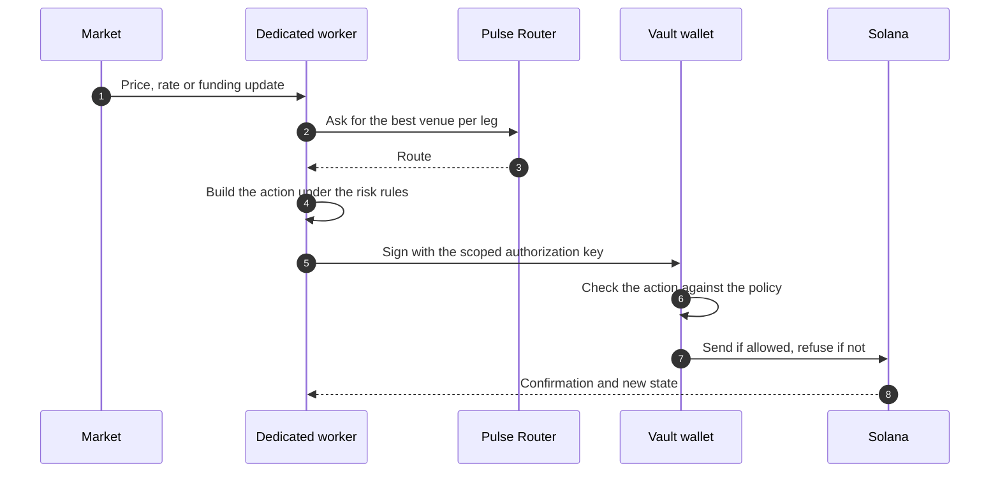

import { Term } from "/snippets/term.mdx";

## Components

A Thaler vault is made of five parts. Each has one responsibility.

| Component | Responsibility | Today (private beta) | After the audit |
|-----------|----------------|----------------------|-----------------|
| Vault wallet | Holds the deposit, the positions and the accrued yield | Privy agentic wallet, one per vault | Squads smart account, one per vault |
| Policy | Lists what the vault is allowed to do | Fixed at creation, enforced on signing | Immutable, enforced on chain |
| Dedicated worker | Runs your strategy and risk profile | Isolated Cloudflare Worker container per vault | Unchanged |
| Risk engine | Watches every leg and fires safety triggers | Rule-based, no manual intervention | Unchanged, under audit |
| Pulse Router | Chooses the best LST, lending market and perpetual venue | Live since v1.1 | Unchanged |

The vault wallet is the address of record. Funds enter and leave through it, and every action it signs must match its policy.

## The dedicated worker

Every vault gets its own worker: an isolated Cloudflare Worker container that runs only your strategy and risk profile. It reads market conditions, proposes actions, and signs them through the vault's scoped authorization key. It never holds your wallet's private key.

Isolation means a problem in one vault's worker does not reach any other vault.

## Pulse Router

<Term
  word="Pulse Router"
  part="proper noun"
  phonetic="puls · roo · ter"
  example="Pulse Router moved the hedge to the venue with better funding."
>
  The part of the Thaler engine that compares supported staking tokens, lending markets and perpetual venues, and routes each vault to the best one at the time.
</Term>

Pulse Router shipped with v1.1 on 24 September 2026, when the strategy went from one venue per leg to several.

| Leg | What Pulse compares | Options today |
|-----|---------------------|---------------|
| Staking | Yield across supported liquid staking tokens | Nine LSTs |
| Lending | Borrow rates and spread across lending markets | Kamino, Jupiter Lend |
| Hedge | Funding conditions across perpetual venues | Pacifica, Phoenix, Bulk (in testing) |

## The risk engine

The risk engine watches both sides of the strategy continuously and acts on deterministic rules. Every market move maps to a defined response.

| Condition | Response |
|-----------|----------|
| Lending loop APY falls toward a critical level | Delever the loop to keep it earning a positive rate |
| SOL rallies and the short's liquidation buffer thins | Borrow extra SOL from loop headroom and add it as margin |
| SOL falls | Close the short to realise the profit, swap it to SOL, reopen at the new lower price |
| A leg drifts from its target size | Rebalance it back into range |
| An emergency condition is met | Exit through the emergency settlement path |

No human needs to be watching a dashboard for any of these to happen.

## Supporting infrastructure

| Layer | Provider | Role |
|-------|----------|------|
| RPC | Triton One | Fast, reliable transaction landing for rebalances and hedges |
| Swaps | Titan v3 with the DART meta-aggregator | Routes swaps, for example USDC profits back to SOL |
| On-chain programs | Quasar framework, with Blueshift advising | The framework the audited programs are built on |

## Coordination loop

## What you sign

You sign when you create a vault, when you take Yield Upfront, and when you close it. Rebalancing, compounding, auto-claims and auto-repay all run inside the policy without asking you again.

## Next read

<Columns cols={2}>
  <Card title="Custody and policy" icon="key" href="/overview/custody-and-policy">
    Who can move funds, today and after the audit.
  </Card>
  <Card title="Strategies" icon="chart-line" href="/strategies/index">
    The three legs and the six risk profiles.
  </Card>
</Columns>
