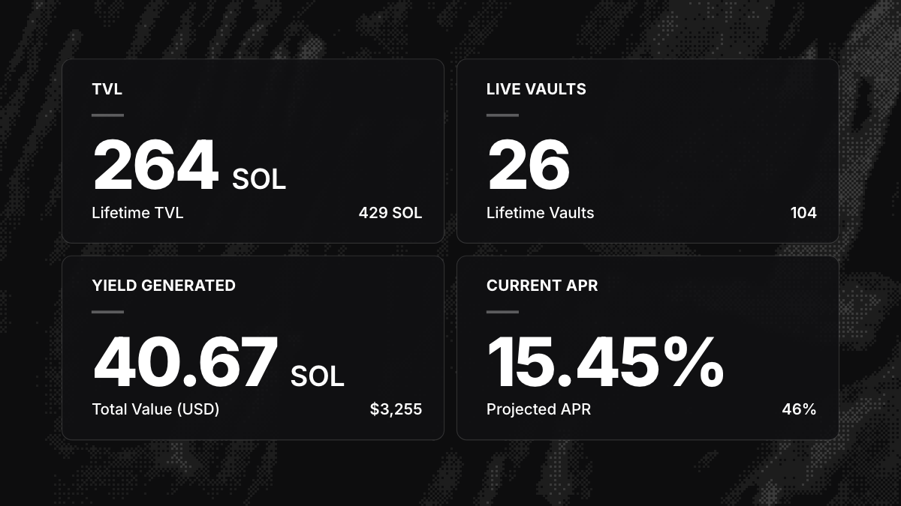
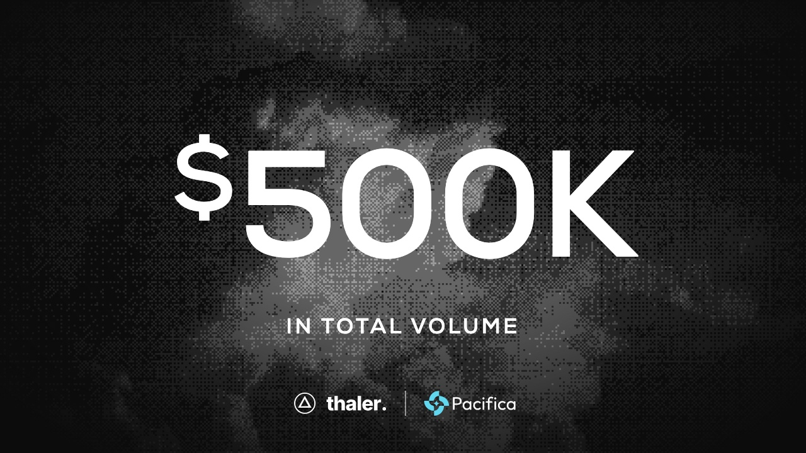

Thaler publishes its numbers as it goes. Everything on this page is a point-in-time snapshot from mainnet. None of it is a forecast.

## Current numbers

| Metric | 13 November 2026 |
|--------|------------------|
| TVL | 264 SOL (about $21K) |
| Lifetime deposits | 429 SOL |
| Live vaults | 26 |
| Lifetime vaults | 104 |
| Yield generated, all time | 40.67 SOL (about $3,255) |
| Current APR | 15.45 % |

## $500K on Pacifica

In November 2026 Thaler vaults crossed $500K in volume on Pacifica. All of it came from vaults working in the background: opening, resizing and resetting hedges for their depositors.

## Timeline

| Date | Milestone |
|------|-----------|
| May to June 2026 | Four weeks of live vaults with the team's own capital. Returned over 15 % in SOL, most of it while SOL was falling |
| 15 June 2026 | Private beta opens with a fixed 2 SOL deposit per vault |
| Late June 2026 | 25 vaults, 50 SOL, 15 depositors, each onboarded on a call |
| Early July 2026 | 50 vaults and 100 SOL. Vault creation time cut from 3 minutes to under 1 minute over the following weeks |
| 2 August 2026 | Round 1 closes. Every vault settles automatically |
| August 2026 | Round 2 opens on the stable risk engine with per-profile deposit bands. Liquidity provision removed from the strategy |
| 24 September 2026 | v1.1: nine LSTs, two lending markets, three perpetual venues, Pulse Router |
| 22 to 23 October 2026 | Maintenance after the Railway security incident. Keys rotated, positions untouched. See [Incident response](/security/incident-response) |
| November 2026 | Auto-compound, auto-claim and Yield Upfront go live. $500K volume on Pacifica |

## Round 1

Round 1 was the first test round of the private beta, at a fixed 2 SOL per vault.

| Metric | Value |
|--------|-------|
| Vaults opened | 64 |
| Unique depositors | 21 |
| Total deposits | 128 SOL |
| Net funding captured on Pacifica | $61.68 |
| Transaction volume | Just over $98K |
| First protocol revenue | 1.51 SOL |

Every vault settled automatically on close, testing the emergency exit and automatic claim triggers. Each tester received their deposit and realised yield minus the 11 % service fee, plus 50 % of their vault creation fee back.

## Round 2 and v1.1

Round 2 runs on the stable version of the risk engine, the same version going to audit, with more safety triggers and layered checks. Deposits moved from a fixed 2 SOL to per-profile bands starting at 6 SOL. See [Strategies](/strategies/index).

| Date | TVL | Live vaults | Yield generated, all time | Return rate |
|------|-----|-------------|---------------------------|-------------|
| 25 September 2026 | 184 SOL | 18 | 14.72 SOL | 8.00 % |
| 15 October 2026 | 178 SOL | 17 | 17.66 SOL | 9.92 % |
| 9 November 2026 | 195 SOL | 19 | 28.83 SOL | 14.80 % |
| 13 November 2026 | 264 SOL | 26 | 40.67 SOL | 15.45 % |

## Stress events

The strategy has been through several hard markets on mainnet. In each case the risk engine acted on its own rules, with no manual intervention.

<AccordionGroup>
  <Accordion title="Two SOL rallies, July 2026">
    SOL ran from $67 to $73, then $73 to $84. A rally is the moment a short hurts. The shorts
    held. Automated extra borrows lifted their liquidation thresholds above $100, and because a
    rising SOL needs less SOL to offset the short's dollar PnL, the vaults gained about 22 % more
    borrowing headroom. Meanwhile the Kamino Multiply loops ran at about 9 to 10 % net APY.
  </Accordion>
  <Accordion title="Record SOL borrow rate spike, 8 July 2026">
    The SOL borrow rate on Kamino hit its highest level on record, pushing one leg to about
    negative 28 % APY at close and briefly near negative 38 %. Safety triggers fired within
    ticks, cut the drag across the fleet by about 87 %, and kept every looping spread in a safe
    range, with the lowest at about negative 2.85 %. The vaults recovered within days.
  </Accordion>
  <Accordion title="$10M Kamino liquidity drain, 26 August 2026">
    About $10 million of SOL left the Kamino market used for the jitoSOL/SOL loop in under an
    hour. This stresses the lending leg rather than the short. The engine delevered where the
    loop APY fell toward a critical level, and backend patches followed within hours. No
    security issues were recorded.
  </Accordion>
  <Accordion title="$74 to $110 rally, late August to September 2026">
    The largest rally the hedge had faced. The short stayed open and the liquidation buffers
    held, because SOL is the collateral for the short: as SOL rises, the dollar value of that
    margin rises with it. Over the window, longs paid shorts more than 85 % of the time.
  </Accordion>
</AccordionGroup>

## Next read

<Columns cols={2}>
  <Card title="Strategies" icon="chart-line" href="/strategies/index">
    The three legs and the six risk profiles.
  </Card>
  <Card title="Risk disclosure" icon="triangle-exclamation" href="/security/risk-disclosure">
    What can still go wrong.
  </Card>
</Columns>
