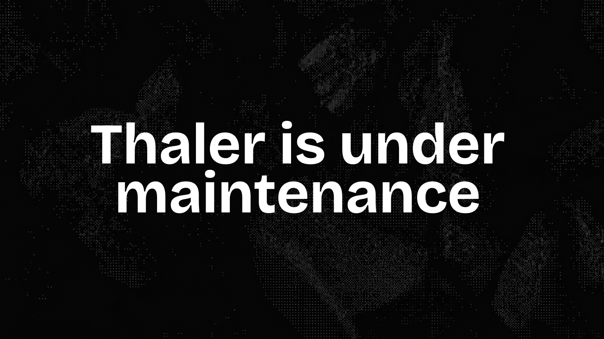

## Principle

Security comes before availability. If there is a credible risk to the infrastructure behind the vaults, Thaler pauses vault actions first and verifies second. A short pause is always preferable to putting user positions at risk.

## What a pause means

| During maintenance | Status |
|--------------------|--------|
| Your positions | Stay in place |
| New vaults, claims and closes | Paused |
| Funds | Not moved |

When the work is done, Thaler announces it is live again and vault actions resume.

## October 2026: Railway security incident

| Date | Action |
|------|--------|
| 22 October 2026 | The Railway security incident comes to light. Thaler is placed under maintenance and vault actions are paused |
| 22 to 23 October 2026 | All keys rotated across Vercel, Privy and Neon. Every existing position stays in place throughout |
| 23 October 2026 | Security measures complete. Thaler is back online and vault actions are restored |

No user positions were affected.

## Where announcements happen

Incident updates are posted on [X (@ThalerFinance)](https://x.com/ThalerFinance) and in the [Discord](https://discord.gg/m3GdTFc4ru). To report a security issue, email [support@thaler.finance](mailto:support@thaler.finance).

## Next read

<Columns cols={2}>
  <Card title="Risk disclosure" icon="triangle-exclamation" href="/security/risk-disclosure">
    The residual risks.
  </Card>
  <Card title="Custody and policy" icon="key" href="/overview/custody-and-policy">
    Who can move funds.
  </Card>
</Columns>
