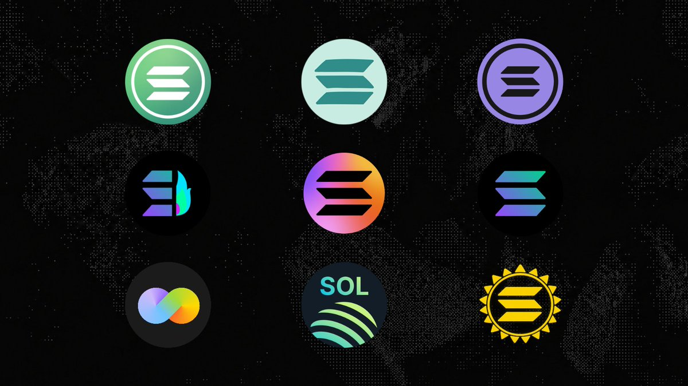

## What it does

Your SOL is staked into a **liquid staking token** (LST). The token earns staking rewards and can still be used in the rest of the strategy.

## Supported tokens

jitoSOL, mSOL, jupSOL, INF, bSOL, stkeSOL, hSOL, pSOL and lanternSOL.

Pulse Router picks the token with the best yield for your vault.

## How you earn

The token slowly becomes worth more SOL. When you close your vault, it is turned back into SOL and the gain is yours.

## Risk

If a staking provider fails or its token loses value against SOL, your vault is affected. See [Risk disclosure](/security/risk-disclosure).
