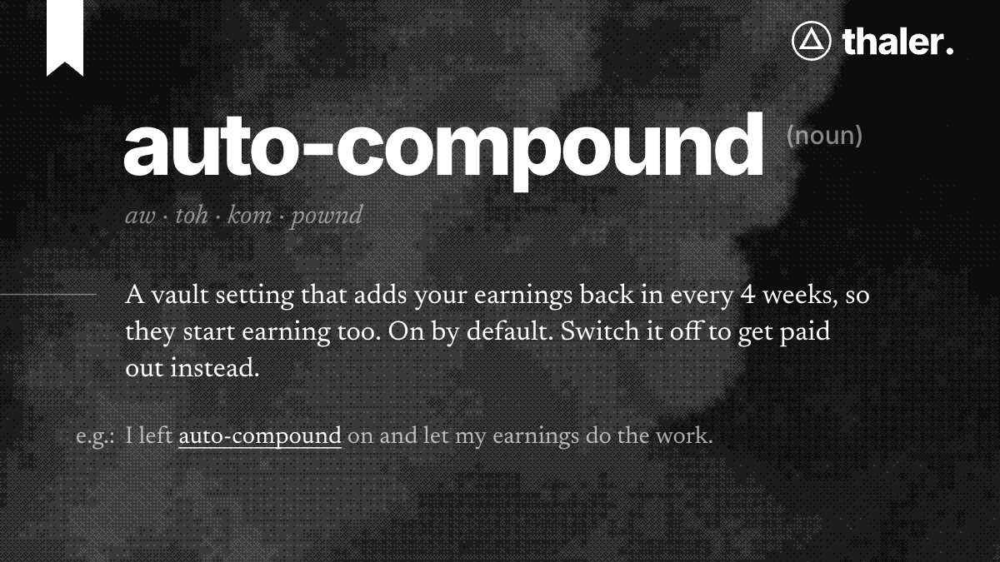
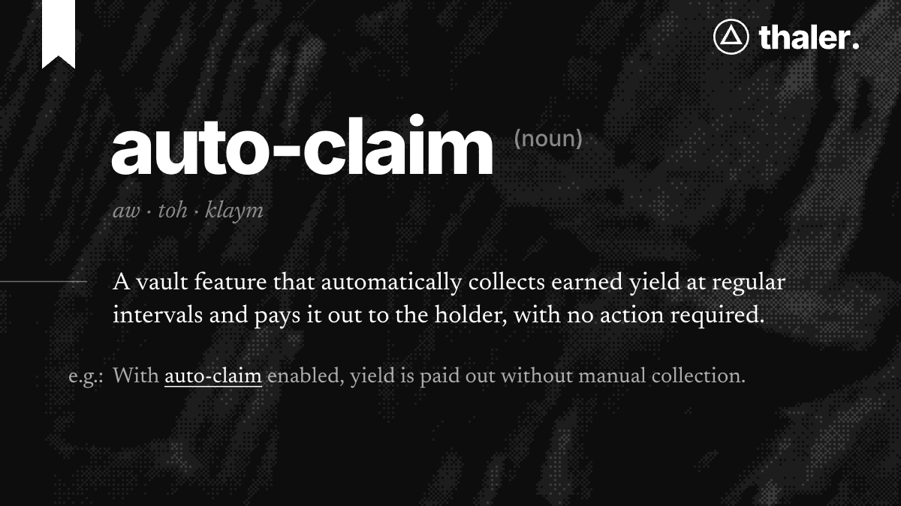

## Every 4 weeks

Your vault collects its yield every 4 weeks, takes the 11 % fee, and then does one of two things.

| Setting | What happens |
|---------|--------------|
| Auto-compound (default) | Yield goes back into your vault and starts earning too |
| Auto-claim | Yield is paid to your wallet |

You do not need to do anything either way.

## Auto-compound

On by default. Switch it off to get paid out instead.

## Auto-claim

Your yield lands in your wallet on schedule.

## Good to know

- Claiming never touches your deposit.
- Claiming does not close your vault.
- If you use [Yield Upfront](/vault/yield-upfront), your yield pays that back first.
