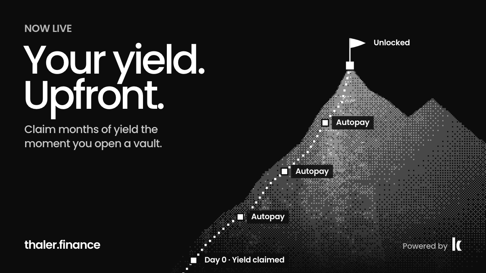

import { Term } from "/snippets/term.mdx";

## Definition

<Term
  word="Yield Upfront"
  part="noun"
  phonetic="yeeld · up · frunt"
  example="I used Yield Upfront to take four months of yield on day one."
>
  A vault option that pays you up to 6 months of expected net yield on the day you open the vault. The vault's own yield repays it over time.
</Term>

Why wait months for yield you already expect? Yield Upfront pays it to you on day one. Spend it, or redeploy it. Your deposit keeps working in the same vault, with the same strategy.

## How it works

<Steps>
  <Step title="Create a vault">
    Open a vault as usual, with any risk profile.
  </Step>
  <Step title="Claim the expected yield on day one">
    Take up to 6 months of the vault's expected net yield. It is drawn from the vault's
    available borrow limit on Kamino.
  </Step>
  <Step title="The vault locks and runs on auto-repay">
    Every yield cycle now goes toward settling your claim instead of to you.
  </Step>
  <Step title="Yield settles the claim">
    The yield the vault generates pays the claim back automatically. There is nothing to do.
  </Step>
  <Step title="Paid off, vault unlocked">
    Once the claim is settled, typically about 4 to 5 months later, the vault unlocks and
    returns to auto-compound or auto-claim.
  </Step>
</Steps>

## Auto-repay

<Term
  word="auto-repay"
  part="noun"
  phonetic="aw · toh · ree · pay"
  example="My vault is on auto-repay until the upfront claim is settled."
>
  The mode a vault switches to after a Yield Upfront claim. Every yield cycle goes to settling the claim instead of to you, until it is paid off and the vault unlocks.
</Term>

## What changes and what does not

| | Normal vault | Vault with Yield Upfront |
|-|--------------|--------------------------|
| Strategy and risk profile | Unchanged | Unchanged |
| When you get yield | Every 4 weeks, as it is earned | Up to 6 months of it on day one |
| Yield cycle | Auto-compound or auto-claim | Auto-repay until settled |
| Closing | After the 4-week lock period | After the claim is settled |

## Things to know

- The amount is based on **expected** net yield, after the 11 % service fee. Actual yield can be higher or lower than expected, which changes how long repayment takes.
- In slower markets the vault earns more slowly, so the claim takes longer to settle. In volatile markets it can settle faster.
- The upfront amount is a borrow against the vault's lending position on Kamino. It uses headroom the loop already keeps, and the risk engine continues to manage the loop's safety as usual.
- The vault cannot be closed until the claim is settled.

## Next read

<Columns cols={2}>
  <Card title="Lending markets" icon="banknote" href="/strategies/lending-markets">
    The loop whose headroom funds Yield Upfront.
  </Card>
  <Card title="Closing a vault" icon="vault" href="/vault/close">
    When a vault can be closed.
  </Card>
</Columns>
